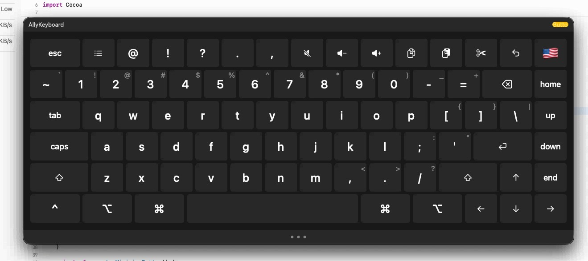

# AllyKeyboard

[](https://github.com/umkasanki/ally-keyboard/actions/workflows/core-tests.yml)
[](https://github.com/umkasanki/ally-keyboard/releases/latest)

A floating virtual keyboard for macOS with improved usability, designed for head-tracker / headmouse users.



## What it is

AllyKeyboard is a clickable on-screen keyboard that stays on top of all windows. It lets users who rely on a headmouse or similar pointing device type without a physical keyboard — every key is a large click target, and it never steals focus from the app you're typing into. Inspired by Hot Virtual Keyboard on Windows, built natively for macOS.

## Features

- **Floating, non-activating** window — always on top, clicking keys doesn't steal focus.
- Full QWERTY + number row with symbol variants; **multilingual** layout switching (types and relabels per the active input source).
- **Modifier chords** — sticky Shift / Ctrl / Alt / Cmd (active keys highlight red).
- **Word prediction** and **next-word suggestions** — after a word and a space, the words you usually write next (learned from your own typing, on your Mac only), so a frequent phrase can be finished word by word; a docked balloon (above or below, wherever there's room) that also hosts your **saved phrases** — each phrases key with a list of its own, set in the layout editor; dismisses on outside click.
- **Right-hand action column** — copy / cut / paste / undo (Material icons) + **Translate** (opens the current selection in Google Translate).
- Fixed top-row punctuation and `+ − =` keys, navigation keys (Home/End/PgUp/PgDn/arrows), media/volume keys.
- **Editable layouts** — three built-ins (Standard, Standard Multilingual, Extended) and your own, switched from the menus or a key; a click-only **layout editor** in one window — key sizes, gaps, rows, row alignment, and a key inspector for each key's action (shortcuts, system events, apps, Shortcuts, AppleScript…) and look (icons, a second icon for start / stop keys); layouts shared as files. See [Layouts](#layouts).
- **Floating launcher** when collapsed — draggable, remembers its position, adjustable width/opacity.
- **Settings** — keyboard size (%), top/bottom bar heights (+ hide bottom bar), suggestions toggle & learned words, launcher width/opacity, launch-at-login, launch-collapsed, and two dark themes (custom / macOS system colors).
- Dimmed function keys that brighten on hover/press, pointing-hand cursor, menu-bar + right-click control, runs as a **menu-bar accessory** (no Dock icon).

## Layouts

The keys on the keyboard come from a **layout**. Three are built in:

- **Standard** — the default: QWERTY, the number row, editing and media keys.
- **Standard Multilingual** — Standard with the input-language key (it cycles
  the input sources enabled in macOS) in place of Screenshot.
- **Extended** — Standard plus the input-language key and a Home / Page Up /
  Page Down / End column.

Switch layouts from the menu-bar icon or the right-click menu (**Layout ▸**),
or with a *Next Layout* key. **Layout ▸ Edit Layouts…** opens the editor.

### The editor

One window. The keyboard is drawn large on the left; on the right is a column
for the keyboard as a whole, which becomes the **key inspector** while a key
is edited. Everything is a single click on a large button: no drag and drop,
no double clicks, nothing that appears only on hover. Undo and Redo take back
any change; nothing is written to disk until **Save** (**Revert** drops the
edits).

- **Top bar** — the layout being edited, **New ▸** (an almost empty layout, or
  macOS's **Accessibility Keyboard**, its Panels button being Choose Layout),
  Duplicate, Rename, Delete (**Reset to Factory** for a built-in), Import,
  Export; Undo, Redo, Revert, Save.
- **The keyboard as a whole** — key width and height, the gaps between keys
  and rows, the padding and the number of rows, each with − / +; **Align
  rows** Left, Centre or Stretch (stretched keys grow, the gaps stay). Each
  row's width is written at its right edge, so uneven rows show; a row
  shorter than the longest has its empty places drawn dashed. Centre turns
  into Left by itself once rows are of different widths.
- **Keys** — click a key to select it, then ◀ ▶ ▲ ▼ (a key moves through
  empty room as well as past other keys), **Swap** (then click the other key),
  **Delete Key**; **Add Group…** puts in a number row, a media row
  (brightness, Mission Control, music, sound) or a Home / Page Up / Page Down
  / End column at once.
- **Add Key…** and **Edit Key…** open the inspector in the right-hand column.
  Every change shows on the key at once and is one Undo step; clicking
  another key moves the inspector to it; **Done** goes back to the keyboard
  column.
- **Status bar** at the bottom — the hint for what is on screen, warnings
  (no Space key, uneven rows) and errors (nothing to save).

### The key inspector

**Action** — what the key does:

| Action | |
|---|---|
| None | does nothing |
| Character | a letter, digit or symbol; follows the input source |
| Type Text | types the text as it is, whatever the input source |
| Key | Space, Return, Tab, Delete, Esc, the arrows, Home / End, Page Up / Down |
| Modifier | ⇧ ⌃ ⌥ ⌘ fn, held for the next key; with fn the top row is F1–F12 and the arrows Home, End, Page Up and Down, as on Apple's Accessibility Keyboard |
| Press Keyboard Shortcut | one or more shortcuts, pressed in turn |
| System Event | sound, brightness, music, Mission Control, Spotlight, Launchpad, the input source |
| Keyboard | one of AllyKeyboard's own commands — hide, screenshot, the app switcher, translate, **Show Phrases**, next or chosen layout, settings |
| Open App | an app chosen with **Choose…** |
| Run Command from Shortcuts App | one of your Shortcuts, picked from a list |
| AppleScript | a script, run in the background |
| Empty Space | a gap that keeps the rows lined up |

A **Show Phrases** key has its own list of phrases, one a line, so several
keys can offer different ones.

**Shortcuts** for *Press Keyboard Shortcut* are recorded with **Record…**,
picked from **Common**, or written in the field:

- `⌘C`, `⇧⌘5`, `⌘→`, `⌘Space`, `F13` — modifiers as symbols, then the key
  (F-keys are pressed this way);
- `cmd+shift+5`, `ctrl+alt+delete` — or as words joined by `+`;
- `⌘H, ⇧⌘5` — several shortcuts, pressed one after another, separated by
  commas (spaces optional);
- `⌘⌘` or `⌘, ⌘` — a modifier on its own is pressed and let go by itself:
  this is Command pressed twice, macOS's shortcut for Dictation. **Add Tap**
  adds one without typing (the on-screen ⌘ only arms the next key, so a tap
  cannot be recorded from it);
- the comma key is written `Comma`; letters always by the US layout, whatever
  the input source.

Text the field cannot read turns red and changes nothing.

**Look** — the label, the corner label, the font size, the width, the
**height** (the whole row, or its top or bottom half: a top half followed by
a bottom half share one place, ↑ over ↓, as a Mac's arrows do) and the
**icon**: bundled images and SF Symbols, listed A to Z, with a search field
above the list. **Second icon, every other press** (folded away until
opened) gives a key a second icon it switches to on each press and back on
the next — for a shortcut that starts and stops something, such as a
microphone key for Dictation (`mic`, then `mic.slash`). The keyboard counts
presses: it cannot tell whether the thing was stopped in another way.

### Files

Built-in layouts can be edited too; **Reset to Factory** brings the original
back. Each layout is one JSON file in
`~/Library/Application Support/AllyKeyboard/Layouts`.

**Sharing.** **Export…** writes the layout on screen to an
`.allykeyboard-layout` file (the same JSON); **Import…** reads one. An import
is added beside the layouts already there — never in place of one — and a file
that cannot be read, comes from a newer version of the app, or has no keys is
refused with a message saying why.

## Install

**[Full installation guide →](docs/INSTALL.md)** — what Homebrew is and how to
get it, what to do when macOS blocks the app, and how to grant the permission
it needs.

### Homebrew — recommended

```bash
brew tap umkasanki/tap
brew trust umkasanki/tap          # third-party taps are trusted once
brew install --cask allykeyboard
```

Nothing stands in the way: Homebrew clears the quarantine mark as it installs.
Then allow the app to type — System Settings → Privacy & Security →
Accessibility → enable **AllyKeyboard** — and restart it, since permissions are
read at launch.

### .dmg — if you cannot use Homebrew

Download `AllyKeyboard-<version>.dmg` from the
[latest release](https://github.com/umkasanki/ally-keyboard/releases/latest),
open it, and drag AllyKeyboard into Applications.

**macOS will refuse the first launch.** The app is signed by me rather than by
Apple, and a browser marks everything it downloads, so the refusal is expected
rather than a fault. Allow it in **System Settings → Privacy & Security →
Open Anyway**, then open the app again. Where to find that, and what each dialog
says, is spelled out in the
[installation guide](docs/INSTALL.md#method-2--the-dmg).

Control the keyboard from the **menu-bar icon** (left-click show/hide,
right-click menu) or the floating launcher.

## Build from source

Requires Xcode on macOS.

```bash
git clone https://github.com/umkasanki/ally-keyboard.git
cd ally-keyboard
xcodebuild -project AllyKeyboard/AllyKeyboard.xcodeproj -scheme AllyKeyboard -configuration Release build
```

To keep the Accessibility grant stable across rebuilds, sign with a dedicated self-signed identity — see [`AllyKeyboard/setup-signing.sh`](AllyKeyboard/setup-signing.sh) and [`AllyKeyboard/build-signed.sh`](AllyKeyboard/build-signed.sh).

## Tech stack

- Swift / AppKit (no SwiftUI)
- CGEvent for cross-process key simulation
- Accessibility API (AXUIElement); Text Input Source Services for layout-aware typing
- Non-activating `NSPanel` for the always-on-top, focus-preserving window

## AllyKeyboardCore

Platform-independent domain logic lives in the [`AllyKeyboardCore`](AllyKeyboardCore) Swift
package — no AppKit dependency, so it builds and is unit-tested on Linux (CI) as well as macOS:

- `TextTracker` — tracks the word currently being typed
- `PredictionEngine` — protocol for word completion; `DictionaryPredictionEngine` is the
  portable implementation (a `NSSpellChecker` adapter plugs in on macOS)
- `SuggestionApplier` — computes the minimal keystrokes to replace a partial word with a suggestion
- `SuggestionSession` / `NextWords` / `BalloonCursor` — what the suggestion balloon offers (the rest
  of the word, or the next words), what a pick sends through a `KeyEventSink`, what is learned,
  and the arrow keys over the balloon — tested end to end by typing into a sink
- `Settings` / `SettingsStore` — persisted, lenient-decoding settings model
- `KeyboardLayout` / `LayoutStore` / `LayoutEditor` — layouts as data, their files, import
  and export, and every editing operation (undoable)

```bash
cd AllyKeyboardCore && swift test
```

The macOS app links this package locally and supplies the AppKit UI and key simulation.

## Status

Personal-use project, not distributed via the App Store. See [`PLAN.md`](PLAN.md) for the roadmap.
