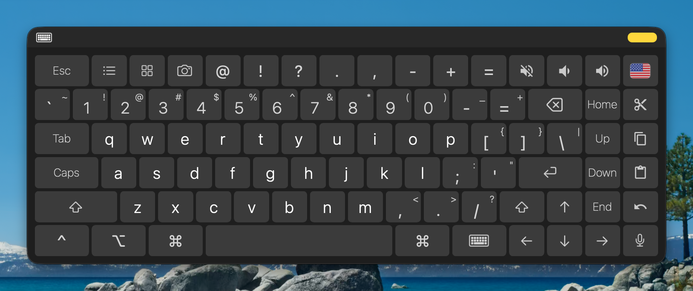
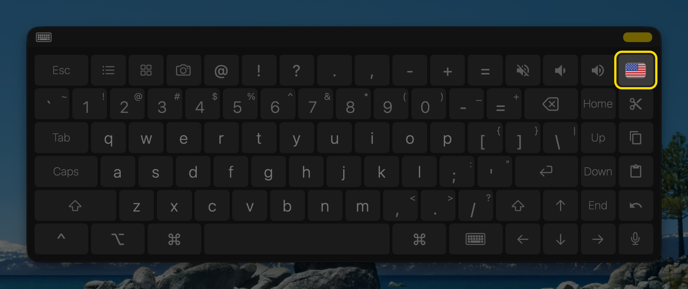
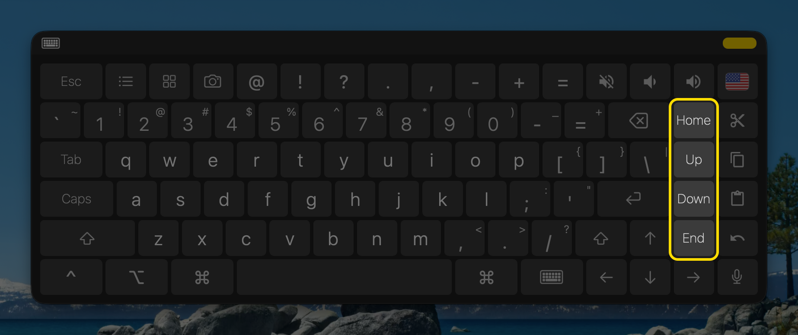
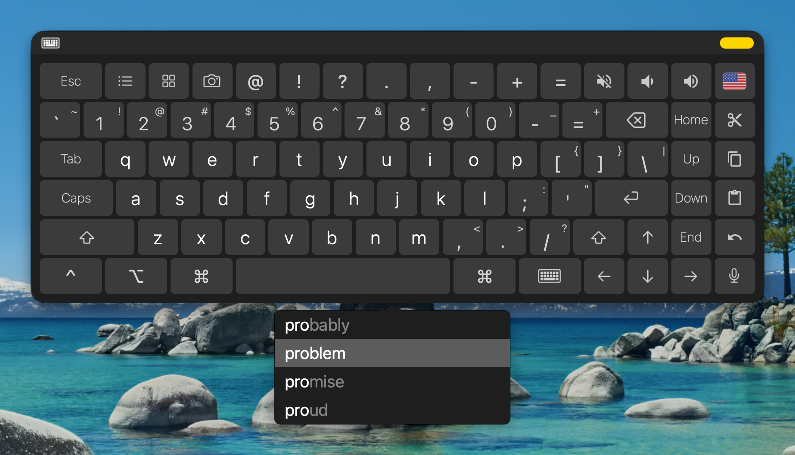

<h1 align="center">AllyKeyboard</h1>

<p align="center">
  A native macOS <b>on-screen keyboard</b> for head-tracker and other pointer-only users.
</p>

<p align="center">
  <a href="https://github.com/umkasanki/ally-keyboard/releases/latest"></a>
  <a href="https://github.com/umkasanki/ally-keyboard/releases"></a>
  <a href="https://github.com/umkasanki/ally-keyboard/actions/workflows/core-tests.yml"></a>
  
</p>

<p align="center">
  
</p>

Click the keys with whatever moves your pointer — a head tracker, an eye
tracker, a trackball. The keyboard floats above every window and **never takes
the focus** from the app you are typing into. Large keys, suggestions that
learn your words, and one big button to tuck it away. Built for a user who
types everything this way, every day.

Inspired by [Hot Virtual Keyboard](https://hot-virtual-keyboard.com/) on Windows.

---

## Why another on-screen keyboard?

macOS comes with a good on-screen keyboard of its own, the **Accessibility
Keyboard**, and for occasional typing it does the job well. AllyKeyboard is
made for a different day: typing everything with a head tracker, for hours,
where every extra aim costs effort. Two things shaped it more than anything.

**Hiding it is one big button — and it cannot be closed by a near miss.**
The Accessibility Keyboard hides and closes with small title-bar buttons that
sit side by side. They are hard to hit with a head tracker, and closing it
when you meant to minimise turns it off, so getting it back takes a trip
through settings. AllyKeyboard has a single large yellow button that only
ever collapses it to a small floating launcher; one click on the launcher
brings it back.

**Suggestions you can take in at a glance.** On the Accessibility Keyboard
suggestions run in a row inside the keyboard, right beside the keys you are
aiming at, and a row has to be read word by word. AllyKeyboard shows them in
a separate balloon above or below the keyboard, **one word per line**: a
column is scanned in one look, the keys stay clear, and the keyboard itself
can be smaller. The suggestions also **remember** — the words you use most
come first, and after a word they offer the ones you usually write next.

**Like the look of Apple's keyboard?** Choose the **Accessibility Keyboard**
layout: the same keys in the same places — its top row, a real fn key, the
half-height arrows — with AllyKeyboard's suggestions and its one-button hiding.

---

## Features

### Typing

- **Never steals focus** — a non-activating panel on top of every window,
  full-screen apps included.
- **Sticky modifiers** — ⇧ ⌃ ⌥ ⌘ and **fn** arm the next key and light up red;
  no holding two keys at once.
- **Large keys, quiet chrome** — letters bright, service keys dimmed until the
  pointer is on them; a pointing-hand cursor over every key.
- **Drag any key to move the keyboard**; a plain click still types.

### Two languages, one key

<p align="center">
  
</p>

For people who write in two languages: the language key shows the flag of the
input source in use and switches to the next one enabled in macOS with a single
click. The keys relabel at once — the letters you see are the letters you get.

### Moving around the text

<p align="center">
  
</p>

For people who work with text all day, the **Extended** layout has a column of
navigation keys beside the arrows — **Home**, **Page Up**, **Page Down** and
**End**: to the start or end of the line, a screen up or down, without
reaching for a scroll bar. With ⇧ armed they select as they move; with ⌘, Home
and End go to the start and end of the whole document.

### Suggestions

<p align="center">
  
</p>

- **A balloon beside the keyboard**, above or below wherever there is room, one
  suggestion per line.
- **Your words first** — every word you finish is counted; the ones you use
  lately come first, and your own words (names, terms) appear after two uses.
- **Next-word suggestions** — after a word and a space, the words you usually
  write next; pick word after word to finish a phrase you use often.
- **Arrow keys** walk the balloon and **Return** puts in the chosen word — or
  just click it.
- **Smart space** — a picked word comes with a space; punctuation typed next
  takes it back.
- **Saved phrases** — a phrases key opens a list of your own sentences.
- Learning stays on your Mac, and nothing typed into a password field is kept.

### Layouts you can change

Four built-in layouts — **Standard**, **Standard Multilingual**, **Extended**
and **Accessibility Keyboard** (macOS's own, with a real fn key and half-height
arrows) — and as many of your own as you like.

A **click-only layout editor**: no drag and drop, no double clicks, nothing
that shows only on hover. Change key sizes, gaps and rows; give any key a
character, text, a shortcut or a series of them, a system event (sound,
brightness, music, Mission Control), an app, a Shortcut or an AppleScript; pick
its icon — even a second one it switches to on every other press, for a
microphone key that starts and stops Dictation. Layouts are shared as files.

**[Layouts and the editor →](docs/LAYOUTS.md)**

### Around the keyboard

- **App switcher** — the running apps as large icons; picking one also restores
  its minimised windows, which the system's ⌘Tab does not.
- **Translate** — the selected text in Google Translate, one key.
- **Screenshot**, **media and volume keys**, copy / cut / paste / undo.
- **Menu bar and right-click menus** for everything; no Dock icon.
- **Settings** — keyboard size, bars, suggestions and learned words, launcher
  size and opacity, two dark themes, launch at login, launch collapsed.

---

## Install

**[Full installation guide →](docs/INSTALL.md)** — what Homebrew is and how to
get it, what to do when macOS blocks the app, and how to grant the permission
it needs.

### Homebrew — recommended

```bash
brew tap umkasanki/tap
brew trust umkasanki/tap          # third-party taps are trusted once
brew install --cask allykeyboard
```

Nothing stands in the way: Homebrew clears the quarantine mark as it installs.
Then allow the app to type — System Settings → Privacy & Security →
Accessibility → enable **AllyKeyboard** — and restart it, since permissions are
read at launch.

### .dmg — if you cannot use Homebrew

Download `AllyKeyboard-<version>.dmg` from the
[latest release](https://github.com/umkasanki/ally-keyboard/releases/latest),
open it, and drag AllyKeyboard into Applications.

**macOS will refuse the first launch.** The app is signed by me rather than by
Apple, and a browser marks everything it downloads, so the refusal is expected
rather than a fault. Allow it in **System Settings → Privacy & Security →
Open Anyway**, then open the app again. Where to find that, and what each dialog
says, is spelled out in the
[installation guide](docs/INSTALL.md#method-2--the-dmg-file).

---

## Requirements

- macOS 26 (Tahoe) or later
- **Accessibility permission** (required to type into other apps):
  System Settings → Privacy & Security → Accessibility → enable AllyKeyboard.

AllyKeyboard runs as part of your session and cannot appear on the macOS
**login window**. macOS's own Accessibility Keyboard can, and the
[installation guide](docs/INSTALL.md#typing-at-the-login-screen) says how to
turn it on there.

---

## For maintainers

<details>
<summary><b>Build from source</b></summary>

Requires Xcode on macOS.

```bash
git clone https://github.com/umkasanki/ally-keyboard.git
cd ally-keyboard
xcodebuild -project AllyKeyboard/AllyKeyboard.xcodeproj -scheme AllyKeyboard -configuration Release build
```

To keep the Accessibility grant across rebuilds, sign with a dedicated
self-signed identity: [`tools/setup-signing.sh`](tools/setup-signing.sh) once,
then [`tools/build-install.sh`](tools/build-install.sh) builds, installs to
/Applications and relaunches.

</details>

<details>
<summary><b>Cutting a release</b></summary>

Releases are built by [`.github/workflows/release.yml`](.github/workflows/release.yml).
Push a version tag and the workflow builds the `.dmg` and `.zip` and publishes a
GitHub Release:

```bash
git tag -a v1.10.0 -m "AllyKeyboard 1.10.0" && git push origin v1.10.0
```

Then set the new `version` and the `.dmg`'s `sha256` in `Casks/allykeyboard.rb`
of `umkasanki/homebrew-tap`, commit and push.

</details>

<details>
<summary><b>Project structure</b></summary>

```
AllyKeyboard/          — the macOS app (Swift, AppKit): the keyboard, the
                         suggestion balloon, the layout editor, settings,
                         CGEvent key simulation, Accessibility
AllyKeyboardCore/      — platform-independent logic, unit-tested on macOS and
                         Linux CI: layouts and their editor, suggestions
                         (SuggestionSession, NextWords, UserVocabulary),
                         the word tracker, written shortcuts, settings
tools/                 — build-install, signing, app icon
docs/                  — installation guide, layouts guide, design notes
```

```bash
swift test --package-path AllyKeyboardCore
```

The roadmap and its history are in [`PLAN.md`](PLAN.md).

</details>

---

## Credits

Inspired by **[Hot Virtual Keyboard](https://hot-virtual-keyboard.com/)** — the Windows on-screen keyboard this one follows.  
Made for daily use with a head tracker; personal project, not on the App Store.
