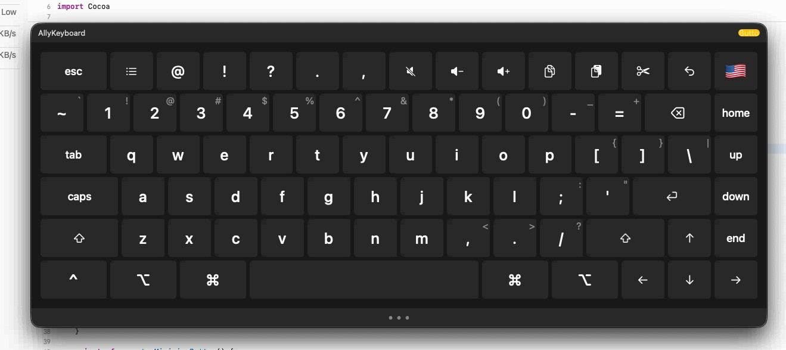

# AllyKeyboard

[](https://github.com/umkasanki/ally-keyboard/actions/workflows/core-tests.yml)
[](https://github.com/umkasanki/ally-keyboard/releases/latest)

A floating virtual keyboard for macOS with improved usability, designed for head-tracker / headmouse users.



## What it is

AllyKeyboard is a clickable on-screen keyboard that stays on top of all windows. It lets users who rely on a headmouse or similar pointing device type without a physical keyboard — every key is a large click target, and it never steals focus from the app you're typing into. Inspired by Hot Virtual Keyboard on Windows, built natively for macOS.

## Features

- **Floating, non-activating** window — always on top, clicking keys doesn't steal focus.
- Full QWERTY + number row with symbol variants; **multilingual** layout switching (types and relabels per the active input source).
- **Modifier chords** — sticky Shift / Ctrl / Alt / Cmd (active keys highlight red).
- **Word prediction** — a docked balloon (above or below, wherever there's room) that also hosts your **saved phrases**; dismisses on outside click.
- **Right-hand action column** — copy / cut / paste / undo (Material icons) + **Translate** (opens the current selection in Google Translate).
- Fixed top-row punctuation and `+ − =` keys, navigation keys (Home/End/PgUp/PgDn/arrows), media/volume keys.
- **Editable layouts** — three built-ins (Standard, Standard Multilingual, Extended) and your own, switched from the menus or a key; a click-only **layout editor** for key sizes, gaps, rows and each key's action and look; layouts shared as files. See [Layouts](#layouts).
- **Floating launcher** when collapsed — draggable, remembers its position, adjustable width/opacity.
- **Settings** — keyboard size (%), top/bottom bar heights (+ hide bottom bar), suggestions toggle & saved-phrase editor, launcher width/opacity, launch-at-login, launch-collapsed, and two dark themes (custom / macOS system colors).
- Dimmed function keys that brighten on hover/press, pointing-hand cursor, menu-bar + right-click control, runs as a **menu-bar accessory** (no Dock icon).

## Layouts

The keys on the keyboard come from a **layout**. Three are built in:

- **Standard** — the default: QWERTY, the number row, editing and media keys.
- **Standard Multilingual** — Standard with the input-language key (it cycles
  the input sources enabled in macOS) in place of Screenshot.
- **Extended** — Standard plus the input-language key and a Home / Page Up /
  Page Down / End column.

Switch layouts from the menu-bar icon or the right-click menu (**Layout ▸**),
or with a *Next Layout* key. **Layout ▸ Edit Layouts…** opens the editor:

- the keyboard as a whole — key width and height, the gaps between keys and
  rows, the padding, the number of rows — each with − / + buttons;
- keys selected with a click, then moved (◀ ▶ ▲ ▼), swapped or deleted;
- **New Key…** and **Edit Key…** — a key's action (picked from a palette, a
  recorded shortcut, or text to type), its label, corner label, icon, width
  and font size;
- Undo / Redo, Save / Revert; a status bar with hints, warnings (no Space key,
  uneven rows) and errors (nothing to save).

Everything is a single click on a large button: no drag and drop, no double
clicks, nothing that appears only on hover.

Built-in layouts can be edited too; **Reset to Factory** brings the original
back. Each layout is one JSON file in
`~/Library/Application Support/AllyKeyboard/Layouts`.

**Sharing.** **Export…** writes the layout on screen to an
`.allykeyboard-layout` file (the same JSON); **Import…** reads one. An import
is added beside the layouts already there — never in place of one — and a file
that cannot be read, comes from a newer version of the app, or has no keys is
refused with a message saying why.

## Install

**[Full installation guide →](docs/INSTALL.md)** — what Homebrew is and how to
get it, what to do when macOS blocks the app, and how to grant the permission
it needs.

### Homebrew — recommended

```bash
brew tap umkasanki/tap
brew trust umkasanki/tap          # third-party taps are trusted once
brew install --cask allykeyboard
```

Nothing stands in the way: Homebrew clears the quarantine mark as it installs.
Then allow the app to type — System Settings → Privacy & Security →
Accessibility → enable **AllyKeyboard** — and restart it, since permissions are
read at launch.

### .dmg — if you cannot use Homebrew

Download `AllyKeyboard-<version>.dmg` from the
[latest release](https://github.com/umkasanki/ally-keyboard/releases/latest),
open it, and drag AllyKeyboard into Applications.

**macOS will refuse the first launch.** The app is signed by me rather than by
Apple, and a browser marks everything it downloads, so the refusal is expected
rather than a fault. Allow it in **System Settings → Privacy & Security →
Open Anyway**, then open the app again. Where to find that, and what each dialog
says, is spelled out in the
[installation guide](docs/INSTALL.md#method-2--the-dmg).

Control the keyboard from the **menu-bar icon** (left-click show/hide,
right-click menu) or the floating launcher.

## Build from source

Requires Xcode on macOS.

```bash
git clone https://github.com/umkasanki/ally-keyboard.git
cd ally-keyboard
xcodebuild -project AllyKeyboard/AllyKeyboard.xcodeproj -scheme AllyKeyboard -configuration Release build
```

To keep the Accessibility grant stable across rebuilds, sign with a dedicated self-signed identity — see [`AllyKeyboard/setup-signing.sh`](AllyKeyboard/setup-signing.sh) and [`AllyKeyboard/build-signed.sh`](AllyKeyboard/build-signed.sh).

## Tech stack

- Swift / AppKit (no SwiftUI)
- CGEvent for cross-process key simulation
- Accessibility API (AXUIElement); Text Input Source Services for layout-aware typing
- Non-activating `NSPanel` for the always-on-top, focus-preserving window

## AllyKeyboardCore

Platform-independent domain logic lives in the [`AllyKeyboardCore`](AllyKeyboardCore) Swift
package — no AppKit dependency, so it builds and is unit-tested on Linux (CI) as well as macOS:

- `TextTracker` — tracks the word currently being typed
- `PredictionEngine` — protocol for word completion; `DictionaryPredictionEngine` is the
  portable implementation (a `NSSpellChecker` adapter plugs in on macOS)
- `SuggestionApplier` — computes the minimal keystrokes to replace a partial word with a suggestion
- `Settings` / `SettingsStore` — persisted, lenient-decoding settings model
- `KeyboardLayout` / `LayoutStore` / `LayoutEditor` — layouts as data, their files, import
  and export, and every editing operation (undoable)

```bash
cd AllyKeyboardCore && swift test
```

The macOS app links this package locally and supplies the AppKit UI and key simulation.

## Status

Personal-use project, not distributed via the App Store. See [`PLAN.md`](PLAN.md) for the roadmap.
